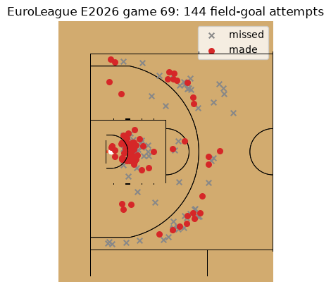
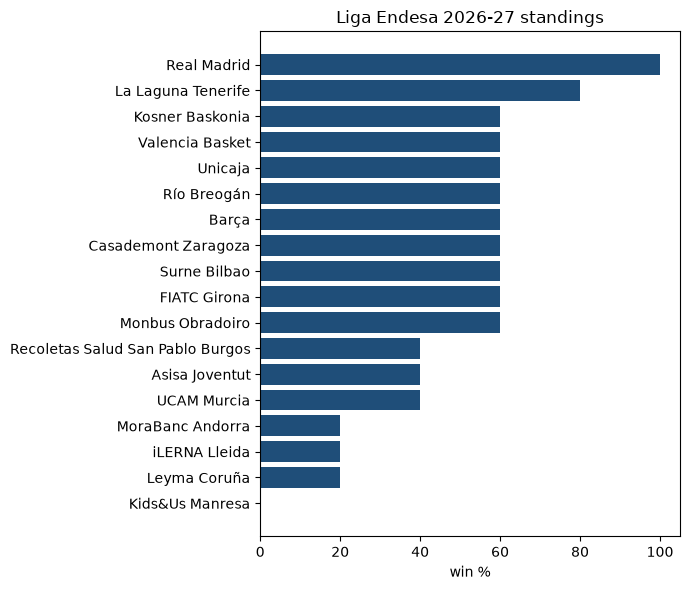

# 🏀🌍 International basketball with `sportsdataverse-py`

> This page is the executed notebook [`16_international_basketball_intro.ipynb`](https://github.com/sportsdataverse/sportsdataverse-py/blob/main/examples/notebooks/16_international_basketball_intro.ipynb): [download it](https://raw.githubusercontent.com/sportsdataverse/sportsdataverse-py/main/examples/notebooks/16_international_basketball_intro.ipynb) to run it yourself.

The NBA is one league; the rest of the basketball world is dozens. `sportsdataverse-py` wraps the
feeds behind the biggest of them, and this notebook tours four:

| League | Module | Provider |
|---|---|---|
| EuroLeague | `sportsdataverse.euroleague` | EuroLeague Competition Engine |
| Super League Basketball (UK) | `sportsdataverse.basketball.genius` | Genius Sports LiveStats |
| NBL (Australia) | `sportsdataverse.basketball.nbl_au` | NBL Rosetta |
| Liga Endesa (Spain) | `sportsdataverse.basketball.acb` | ACB |

No API keys, polars by default (`return_as_pandas=True` for pandas), and at the end a EuroLeague
shot chart drawn on a FIBA court with [sdvplot](https://sdvplot.sportsdataverse.org/). 🎯

## 🧰 The toolbox

| Function | What it gives you |
|---|---|
| [`euroleague_seasons`](../euroleague/reference/euroleague/other.md#euroleague_seasons) | Seasons of a competition (`E` = EuroLeague, `U` = EuroCup) |
| [`euroleague_games`](../euroleague/reference/euroleague/other.md#euroleague_games) | Every game of a season, played or not |
| [`euroleague_standings`](../euroleague/reference/euroleague/other.md#euroleague_standings) | Standings after a round |
| [`euroleague_game_points`](../euroleague/reference/euroleague/game.md#euroleague_game_points) | Shot chart of one game (`coord_x` / `coord_y` in cm) |
| [`slb_competitions`](../genius/reference/additional/genius-sports-livestats-4.md#slb_competitions) | SLB competitions with their END-year season |
| [`slb_schedule`](../genius/reference/additional/genius-sports-livestats-5.md#slb_schedule) | Every match of an SLB season |
| [`slb_player_box`](../genius/reference/additional/genius-sports-livestats-5.md#slb_player_box) | Player box score of a finished SLB game |
| [`slb_shots`](../genius/reference/additional/genius-sports-livestats-5.md#slb_shots) | Shot chart of a finished SLB game |
| [`nbl_rosetta_standings`](../nbl_au/reference/nbl_rosetta/other.md#nbl_rosetta_standings) | NBL regular-season ladder |
| [`nbl_rosetta_matches`](../nbl_au/reference/nbl_rosetta/other.md#nbl_rosetta_matches) | Matches of an NBL season |
| [`acb_standings`](../acb/reference/acb/other.md#acb_standings) | Liga Endesa table after a round |
| [`acb_calendar`](../acb/reference/acb/other-2.md#acb_calendar) | Every round of a season with its games |

Genius LiveStats serves many leagues (`wbbl_*`, `bal_*`, `nznbl_*`, `esake_*`, `lfb_*`, ...) with the
same shape, so the SLB recipes below work for every one of them.

## 🔌 Setup

```sh
pip install "sportsdataverse[sdvplot]"
```

The `sdvplot` extra brings in sdvplot and sportypy for the court drawing.


```python
import matplotlib.pyplot as plt
import polars as pl

from sportsdataverse import euroleague as el
from sportsdataverse.basketball import acb, genius, nbl_au

pl.Config.set_tbl_rows(10)
```


    polars.config.Config


Provider feeds are seasonal and occasionally rate-limited, so a tiny `safe()` helper runs each call
defensively: you get the frame when the feed is up, and a one-line skip when it isn't, naming whether
the answer was *nothing there* (`NoDataError`) or *the fetch failed* (`AssetFetchError`). 🛟


```python
from sportsdataverse.errors import AssetFetchError, NoDataError

def safe(label, thunk):
    try:
        out = thunk()
        print(f"✅ {label}")
        return out
    except (NoDataError, AssetFetchError) as e:
        print(f"\u23ed\ufe0f  {label}: {type(e).__name__}: {e}")
        return None
```

## 🇪🇺 EuroLeague

Season codes are the competition letter plus the START year (`E2025` is 2025-26). We take the newest
season that has a played game, so the notebook works in the off-season too.


```python
seasons = safe("EuroLeague seasons", lambda: el.euroleague_seasons("E"))
season_code, games = None, None
if seasons is not None:
    for code in seasons.sort("year", descending=True)["code"].head(3):
        g = safe(f"games {code}", lambda code=code: el.euroleague_games("E", code))
        if g is not None and g.filter(pl.col("played") == True).height:
            season_code, games = code, g
            break
print("season:", season_code, "| games:", None if games is None else games.shape)
```

    ✅ EuroLeague seasons


    ✅ games E2026
    season: E2026 | games: (380, 94)


```python
played = games.filter(pl.col("played") == True).sort("utc_date") if games is not None else None
cols = ["game_code", "round", "utc_date", "local_club_name", "road_club_name"]
(played.select([c for c in cols if c in played.columns]).tail(5)
 if played is not None and played.height else "no played games")
```


    shape: (5, 5)
    ┌───────────┬───────┬──────────────────────┬──────────────────────┬────────────────────────────┐
    │ game_code ┆ round ┆ utc_date             ┆ local_club_name      ┆ road_club_name             │
    │ ---       ┆ ---   ┆ ---                  ┆ ---                  ┆ ---                        │
    │ str       ┆ i64   ┆ str                  ┆ str                  ┆ str                        │
    ╞═══════════╪═══════╪══════════════════════╪══════════════════════╪════════════════════════════╡
    │ 63        ┆ 7     ┆ 2026-10-22T18:30:00Z ┆ Armani Olimpia Milan ┆ FC Barcelona               │
    │ 66        ┆ 7     ┆ 2026-10-22T18:45:00Z ┆ Partizan Mozzart Bet ┆ Crvena Zvezda Meridianbet  │
    │           ┆       ┆                      ┆ Belgrade             ┆ Belg…                      │
    │ 68        ┆ 7     ┆ 2026-10-23T17:00:00Z ┆ Zalgiris Kaunas      ┆ LDLC ASVEL Villeurbanne    │
    │ 70        ┆ 7     ┆ 2026-10-23T18:15:00Z ┆ Olympiacos Piraeus   ┆ Fenerbahce Tarfin Istanbul │
    │ 69        ┆ 7     ┆ 2026-10-23T18:45:00Z ┆ Paris Basketball     ┆ Valencia Basket            │
    └───────────┴───────┴──────────────────────┴──────────────────────┴────────────────────────────┘


### Standings after the latest round 🏆

[`euroleague_standings`](../euroleague/reference/euroleague/other.md#euroleague_standings) takes the round as a string.


```python
last_round = str(played["round"].max()) if played is not None and played.height else None
stand = safe(f"standings round {last_round}",
             lambda: el.euroleague_standings("E", season_code, last_round)) if last_round else None
cols = ["position", "club_name", "games_played", "games_won", "games_lost", "points_difference"]
(stand.select([c for c in cols if c in stand.columns]).head(10)
 if stand is not None and stand.height else "standings unavailable")
```

    ✅ standings round 7


    shape: (10, 6)
    ┌──────────┬───────────────────────────┬──────────────┬───────────┬────────────┬───────────────────┐
    │ position ┆ club_name                 ┆ games_played ┆ games_won ┆ games_lost ┆ points_difference │
    │ ---      ┆ ---                       ┆ ---          ┆ ---       ┆ ---        ┆ ---               │
    │ i64      ┆ str                       ┆ i64          ┆ i64       ┆ i64        ┆ str               │
    ╞══════════╪═══════════════════════════╪══════════════╪═══════════╪════════════╪═══════════════════╡
    │ 1        ┆ Panathinaikos AKTOR       ┆ 7            ┆ 6         ┆ 1          ┆ +96               │
    │          ┆ Athens                    ┆              ┆           ┆            ┆                   │
    │ 2        ┆ Fenerbahce Tarfin         ┆ 7            ┆ 6         ┆ 1          ┆ +57               │
    │          ┆ Istanbul                  ┆              ┆           ┆            ┆                   │
    │ 3        ┆ Valencia Basket           ┆ 7            ┆ 5         ┆ 2          ┆ +57               │
    │ 4        ┆ Olympiacos Piraeus        ┆ 7            ┆ 5         ┆ 2          ┆ +37               │
    │ 5        ┆ Hapoel IBI Tel Aviv       ┆ 7            ┆ 5         ┆ 2          ┆ +29               │
    │ 6        ┆ Dubai Basketball          ┆ 7            ┆ 5         ┆ 2          ┆ +13               │
    │ 7        ┆ Real Madrid               ┆ 7            ┆ 4         ┆ 3          ┆ +37               │
    │ 8        ┆ Crvena Zvezda Meridianbet ┆ 7            ┆ 4         ┆ 3          ┆ +28               │
    │          ┆ Belg…                     ┆              ┆           ┆            ┆                   │
    │ 9        ┆ FC Barcelona              ┆ 7            ┆ 4         ┆ 3          ┆ +17               │
    │ 10       ┆ Virtus Bologna            ┆ 7            ┆ 4         ┆ 3          ┆ -2                │
    └──────────┴───────────────────────────┴──────────────┴───────────┴────────────┴───────────────────┘


### A shot chart on a FIBA court 🎯

[`euroleague_game_points`](../euroleague/reference/euroleague/game.md#euroleague_game_points) returns one row
per field-goal attempt and made free throw, in centimeters with the hoop at the origin.
`sdvplot.court_coords(..., provider="euroleague")` converts that frame to meters on the FIBA court
that `sdvplot.surface("fiba")` draws (free throws, encoded `-1, -1`, become null). Both teams shoot at
one basket, so we draw the defensive half.


```python
import sdvplot

gcode = str(played["game_code"][-1]) if played is not None and played.height else None
pts = safe(f"shots game {gcode}", lambda: el.euroleague_game_points(gcode, season_code)) if gcode else None
if pts is not None and pts.height:
    shots = sdvplot.court_coords(pts, x="coord_x", y="coord_y", provider="euroleague")
    shots = shots.filter(pl.col("court_x").is_not_null())
    made = shots.filter(pl.col("id_action").is_in(["2FGM", "3FGM"]))
    missed = shots.filter(pl.col("id_action").is_in(["2FGA", "3FGA"]))
    ax = sdvplot.surface("fiba", display_range="defense")
    ax.scatter(missed["court_x"], missed["court_y"], marker="x", s=30, c="#888888", zorder=20, label="missed")
    ax.scatter(made["court_x"], made["court_y"], s=30, c="#d62728", zorder=21, label="made")
    ax.legend(loc="upper right")
    ax.set_title(f"EuroLeague {season_code} game {gcode}: {shots.height} field-goal attempts")
    plt.show()
else:
    print("no shot data for this game")
```

    ✅ shots game 69





## 🇬🇧 Super League Basketball (Genius Sports)

[`slb_competitions`](../genius/reference/additional/genius-sports-livestats-4.md#slb_competitions) lists the SLB competitions
Genius hosts; [`slb_schedule`](../genius/reference/additional/genius-sports-livestats-5.md#slb_schedule) defaults to the current one.


```python
comps = safe("SLB competitions", genius.slb_competitions)
comps.select([c for c in ["comp_id", "label", "season"] if c in comps.columns]).head() if comps is not None else None
```

    ✅ SLB competitions


    shape: (5, 3)
    ┌─────────┬──────────────────────┬────────┐
    │ comp_id ┆ label                ┆ season │
    │ ---     ┆ ---                  ┆ ---    │
    │ i64     ┆ str                  ┆ i64    │
    ╞═════════╪══════════════════════╪════════╡
    │ 49597   ┆ Championship 26-27   ┆ 2027   │
    │ 39625   ┆ Championship 2024-25 ┆ 2025   │
    │ 41897   ┆ Championship 2025-26 ┆ 2026   │
    │ 49599   ┆ Cup 26-27            ┆ 2027   │
    │ 39732   ┆ Cup 2024-25          ┆ 2025   │
    └─────────┴──────────────────────┴────────┘


```python
sched = safe("SLB schedule", genius.slb_schedule)
done = sched.filter(pl.col("status") == "COMPLETE") if sched is not None else None
cols = ["match_id", "date_time", "home_team_name", "home_score", "away_team_name", "away_score"]
(done.select([c for c in cols if c in done.columns]).tail(5)
 if done is not None and done.height else "no completed SLB games yet")
```

    ✅ SLB schedule


    shape: (5, 6)
    ┌──────────┬───────────────┬──────────────────────┬────────────┬──────────────────┬────────────┐
    │ match_id ┆ date_time     ┆ home_team_name       ┆ home_score ┆ away_team_name   ┆ away_score │
    │ ---      ┆ ---           ┆ ---                  ┆ ---        ┆ ---              ┆ ---        │
    │ i64      ┆ str           ┆ str                  ┆ i64        ┆ str              ┆ i64        │
    ╞══════════╪═══════════════╪══════════════════════╪════════════╪══════════════════╪════════════╡
    │ 2882466  ┆ Oct 23, 2026, ┆ Leicester Riders     ┆ 87         ┆ Manchester       ┆ 89         │
    │          ┆ 7:30 PM       ┆                      ┆            ┆ Basketball       ┆            │
    │ 2882469  ┆ Oct 23, 2026, ┆ Newcastle Eagles     ┆ 82         ┆ Surrey 89ers     ┆ 55         │
    │          ┆ 7:30 PM       ┆                      ┆            ┆                  ┆            │
    │ 2882472  ┆ Oct 24, 2026, ┆ London Lions         ┆ 82         ┆ Bristol Flyers   ┆ 76         │
    │          ┆ 6:00 PM       ┆                      ┆            ┆                  ┆            │
    │ 2882446  ┆ Oct 25, 2026, ┆ Liverpool Basketball ┆ 77         ┆ Newcastle Eagles ┆ 74         │
    │          ┆ 4:00 PM       ┆                      ┆            ┆                  ┆            │
    │ 2882449  ┆ Oct 25, 2026, ┆ Cheshire Phoenix     ┆ 91         ┆ Surrey 89ers     ┆ 107        │
    │          ┆ 5:30 PM       ┆                      ┆            ┆                  ┆            │
    └──────────┴───────────────┴──────────────────────┴────────────┴──────────────────┴────────────┘


### One game: box score and shots 📋

Take the latest completed `match_id`, then the player box score
([`slb_player_box`](../genius/reference/additional/genius-sports-livestats-5.md#slb_player_box)) and the shot chart
([`slb_shots`](../genius/reference/additional/genius-sports-livestats-5.md#slb_shots), x/y as a percent of the full court).


```python
mid = int(done["match_id"][-1]) if done is not None and done.height else None
box = safe(f"SLB box {mid}", lambda: genius.slb_player_box(mid)) if mid else None
cols = ["name", "minutes", "points", "rebounds_total", "assists", "field_goals_made", "field_goals_attempted"]
(box.select([c for c in cols if c in box.columns]).sort("points", descending=True).head(8)
 if box is not None and box.height and "points" in box.columns else "box score unavailable")
```

    ✅ SLB box 2882449


    shape: (8, 7)
    ┌────────────────┬─────────┬────────┬────────────────┬─────────┬─────────────────┬─────────────────┐
    │ name           ┆ minutes ┆ points ┆ rebounds_total ┆ assists ┆ field_goals_mad ┆ field_goals_att │
    │ ---            ┆ ---     ┆ ---    ┆ ---            ┆ ---     ┆ e               ┆ empted          │
    │ str            ┆ str     ┆ i64    ┆ i64            ┆ i64     ┆ ---             ┆ ---             │
    │                ┆         ┆        ┆                ┆         ┆ i64             ┆ i64             │
    ╞════════════════╪═════════╪════════╪════════════════╪═════════╪═════════════════╪═════════════════╡
    │ A. Patterson   ┆ 18:55   ┆ 20     ┆ 3              ┆ 1       ┆ 5               ┆ 10              │
    │ E. Reynolds Ii ┆ 29:22   ┆ 18     ┆ 3              ┆ 5       ┆ 5               ┆ 13              │
    │ J. Graham      ┆ 26:37   ┆ 17     ┆ 4              ┆ 3       ┆ 7               ┆ 11              │
    │ C. Mcgill      ┆ 31:13   ┆ 16     ┆ 3              ┆ 2       ┆ 6               ┆ 9               │
    │ J. Searles     ┆ 25:48   ┆ 15     ┆ 4              ┆ 4       ┆ 5               ┆ 9               │
    │ J. Hinds       ┆ 23:10   ┆ 14     ┆ 2              ┆ 0       ┆ 6               ┆ 11              │
    │ R. Cisarik     ┆ 30:33   ┆ 13     ┆ 4              ┆ 2       ┆ 5               ┆ 7               │
    │ R. Stewart     ┆ 11:45   ┆ 11     ┆ 2              ┆ 0       ┆ 4               ┆ 5               │
    └────────────────┴─────────┴────────┴────────────────┴─────────┴─────────────────┴─────────────────┘


```python
sh = safe(f"SLB shots {mid}", lambda: genius.slb_shots(mid)) if mid else None
(sh.group_by("action_type", "result").len().sort("action_type")
 if sh is not None and sh.height else "no shots for this game")
```

    ✅ SLB shots 2882449


    shape: (4, 3)
    ┌─────────────┬────────┬─────┐
    │ action_type ┆ result ┆ len │
    │ ---         ┆ ---    ┆ --- │
    │ str         ┆ i64    ┆ u32 │
    ╞═════════════╪════════╪═════╡
    │ 2pt         ┆ 0      ┆ 27  │
    │ 2pt         ┆ 1      ┆ 43  │
    │ 3pt         ┆ 0      ┆ 42  │
    │ 3pt         ┆ 1      ┆ 26  │
    └─────────────┴────────┴─────┘


## 🇦🇺 NBL (Australia)

The NBL's Rosetta API takes the season as its END year.
[`nbl_rosetta_standings`](../nbl_au/reference/nbl_rosetta/other.md#nbl_rosetta_standings) gives the ladder;
[`nbl_rosetta_matches`](../nbl_au/reference/nbl_rosetta/other.md#nbl_rosetta_matches) the match list.


```python
nbl_season = 2026
ladder = safe(f"NBL ladder {nbl_season}", lambda: nbl_au.nbl_rosetta_standings(nbl_season))
cols = ["position", "team_name", "won", "lost", "win_percentage", "points_for", "points_against", "streak"]
(ladder.select([c for c in cols if c in ladder.columns]).sort("position")
 if ladder is not None and ladder.height else "ladder unavailable")
```

    ✅ NBL ladder 2026


    shape: (10, 8)
    ┌──────────┬──────────────────┬─────┬──────┬────────────────┬────────────┬────────────────┬────────┐
    │ position ┆ team_name        ┆ won ┆ lost ┆ win_percentage ┆ points_for ┆ points_against ┆ streak │
    │ ---      ┆ ---              ┆ --- ┆ ---  ┆ ---            ┆ ---        ┆ ---            ┆ ---    │
    │ i64      ┆ str              ┆ i64 ┆ i64  ┆ f64            ┆ i64        ┆ i64            ┆ i64    │
    ╞══════════╪══════════════════╪═════╪══════╪════════════════╪════════════╪════════════════╪════════╡
    │ 1        ┆ Sydney Kings     ┆ 24  ┆ 9    ┆ 0.7273         ┆ 3276       ┆ 2879           ┆ 11     │
    │ 2        ┆ Adelaide 36ers   ┆ 23  ┆ 10   ┆ 0.697          ┆ 3042       ┆ 2890           ┆ 0      │
    │ 3        ┆ South East       ┆ 22  ┆ 11   ┆ 0.6667         ┆ 3324       ┆ 3061           ┆ 0      │
    │          ┆ Melbourne        ┆     ┆      ┆                ┆            ┆                ┆        │
    │          ┆ Phoenix          ┆     ┆      ┆                ┆            ┆                ┆        │
    │ 4        ┆ Perth Wildcats   ┆ 21  ┆ 12   ┆ 0.6364         ┆ 2996       ┆ 2840           ┆ 1      │
    │ 5        ┆ Melbourne United ┆ 20  ┆ 13   ┆ 0.6061         ┆ 3041       ┆ 2905           ┆ 1      │
    │ 6        ┆ Tasmania         ┆ 14  ┆ 19   ┆ 0.4242         ┆ 2873       ┆ 2884           ┆ 0      │
    │          ┆ JackJumpers      ┆     ┆      ┆                ┆            ┆                ┆        │
    │ 7        ┆ NZ Breakers      ┆ 13  ┆ 20   ┆ 0.3939         ┆ 3022       ┆ 3058           ┆ 1      │
    │ 8        ┆ Illawarra Hawks  ┆ 13  ┆ 20   ┆ 0.3939         ┆ 3074       ┆ 3205           ┆ 2      │
    │ 9        ┆ Cairns Taipans   ┆ 9   ┆ 24   ┆ 0.2727         ┆ 2754       ┆ 3194           ┆ 0      │
    │ 10       ┆ Brisbane Bullets ┆ 6   ┆ 27   ┆ 0.1818         ┆ 2710       ┆ 3196           ┆ 0      │
    └──────────┴──────────────────┴─────┴──────┴────────────────┴────────────┴────────────────┴────────┘


```python
matches = safe(f"NBL matches {nbl_season}", lambda: nbl_au.nbl_rosetta_matches(nbl_season))
(matches.group_by("match_status").len() if matches is not None and "match_status" in matches.columns
 else "matches unavailable")
```

    ✅ NBL matches 2026


    shape: (2, 2)
    ┌──────────────┬─────┐
    │ match_status ┆ len │
    │ ---          ┆ --- │
    │ str          ┆ u32 │
    ╞══════════════╪═════╡
    │ draft        ┆ 3   │
    │ complete     ┆ 206 │
    └──────────────┴─────┘


## 🇪🇸 Liga Endesa (ACB)

[`acb_standings`](../acb/reference/acb/other.md#acb_standings) defaults to the table after the current round;
[`acb_calendar`](../acb/reference/acb/other-2.md#acb_calendar) lists every round of the season in one call.
A bar chart of the table makes the early-season race easy to read.


```python
table = safe("ACB standings", acb.acb_standings)
if table is not None and table.height:
    t = table.sort("win_pct", "plus_minus")
    fig, ax = plt.subplots(figsize=(7, 6))
    ax.barh(t["team"], t["win_pct"], color="#1f4e79")
    ax.set_xlabel("win %")
    end = int(t["season"][0])  # END year
    ax.set_title(f"Liga Endesa {end - 1}-{str(end)[2:]} standings")
    plt.tight_layout()
    plt.show()
else:
    print("ACB standings unavailable")
```

    ✅ ACB standings





```python
cal = safe("ACB calendar", acb.acb_calendar)
(cal.group_by("round_number").agg(games=pl.len(), played=pl.col("home_score").is_not_null().sum())
    .sort("round_number").head(8) if cal is not None and cal.height else "calendar unavailable")
```

    ✅ ACB calendar


    shape: (8, 3)
    ┌──────────────┬───────┬────────┐
    │ round_number ┆ games ┆ played │
    │ ---          ┆ ---   ┆ ---    │
    │ i64          ┆ u32   ┆ u32    │
    ╞══════════════╪═══════╪════════╡
    │ 1            ┆ 9     ┆ 9      │
    │ 2            ┆ 9     ┆ 9      │
    │ 3            ┆ 9     ┆ 9      │
    │ 4            ┆ 9     ┆ 9      │
    │ 5            ┆ 9     ┆ 9      │
    │ 6            ┆ 9     ┆ 9      │
    │ 7            ┆ 9     ┆ 9      │
    │ 8            ┆ 9     ┆ 9      │
    └──────────────┴───────┴────────┘


## 🎉 Where to next

- Every Genius league (`wbbl_`, `bal_`, `nznbl_`, `esake_`, `lfb_`, `lnbm_`, `lub_`) has the same
  `_schedule` / `_player_box` / `_pbp` / `_shots` set as SLB.
- More homes under `sportsdataverse.basketball`: `fiba_hub`, `atrium`, `feb`, `scb`, `lba`, `vtb`,
  `kbl`, `bleague`, `cebl`, `aba` and others; each has a reference page in the sidebar.
- Shot charts: [sdvplot](https://sdvplot.sportsdataverse.org/)'s `court_coords` also converts NBA and
  WNBA stats-API shots (`provider="nba"`).
- NBA, WNBA and college basketball have their own notebooks (`04`, `08`, `06`, `05`).
