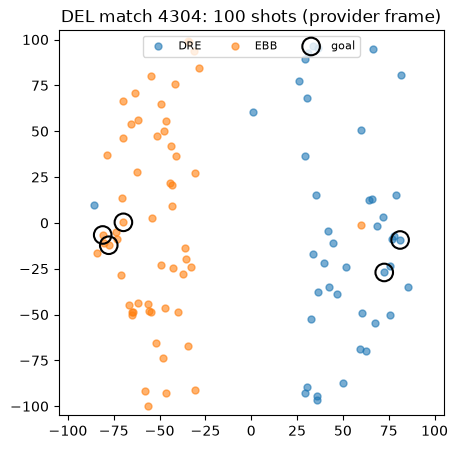
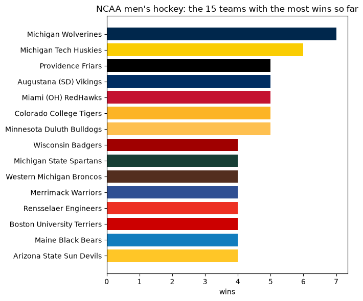

# 🏒🌍 European and college hockey with `sportsdataverse-py`

> This page is the executed notebook [`17_european_college_hockey_intro.ipynb`](https://github.com/sportsdataverse/sportsdataverse-py/blob/main/examples/notebooks/17_european_college_hockey_intro.ipynb): [download it](https://raw.githubusercontent.com/sportsdataverse/sportsdataverse-py/main/examples/notebooks/17_european_college_hockey_intro.ipynb) to run it yourself.

North America's minor and junior leagues have their own notebook (`11_junior_hockey_intro`). This one
crosses the Atlantic and drops into the NCAA:

| League | Module | Provider |
|---|---|---|
| SHL (Sweden) | `sportsdataverse.hockey.shl` | shl.se |
| Liiga (Finland) | `sportsdataverse.hockey.liiga` | liiga.fi |
| DEL (Germany) | `sportsdataverse.hockey.del_` | DEL (eSports feed) |
| KHL | `sportsdataverse.hockey.khl` | khl.ru |
| NCAA men's / women's hockey | `sportsdataverse.hockey.mch` / `.wch` | ESPN |

DEL's package is `del_`, because `del` is a Python keyword. The European runtimes take the season as
its END year (2026 is 2025-26) and space requests at least a second apart, so be patient. ⏳

## 🧰 The toolbox

| Function | What it gives you |
|---|---|
| [`shl_schedule`](../shl/reference/shl/other.md#shl_schedule) | Schedule and results of an SHL season |
| [`shl_pbp`](../shl/reference/shl/other.md#shl_pbp) | SHL play-by-play with shot locations (2023/24 on) |
| [`liiga_standings`](../liiga/reference/liiga/other.md#liiga_standings) | Liiga standings |
| [`liiga_games`](../liiga/reference/liiga/other.md#liiga_games) | Every Liiga game of a season, with xG |
| [`liiga_shotmap`](../liiga/reference/liiga/other.md#liiga_shotmap) | One Liiga game's shots |
| [`del_schedule`](../del/reference/del_esports.md#del_schedule) | DEL schedule and results |
| [`del_standings`](../del/reference/del_esports.md#del_standings) | DEL standings |
| [`del_shots`](../del/reference/del_esports.md#del_shots) | One DEL game's shots with rink coordinates |
| [`khl_standings`](../khl/reference/khl_rest.md#khl_standings) | KHL regular-season standings |
| [`espn_mch_standings`](../mch/reference/site.md#espn_mch_standings) | NCAA men's hockey standings |
| [`espn_wch_scoreboard`](../wch/reference/site.md#espn_wch_scoreboard) | NCAA women's hockey scoreboard |

## 🔌 Setup

```sh
pip install "sportsdataverse[sdvplot]"
```


```python
import matplotlib.pyplot as plt
import polars as pl

from sportsdataverse.hockey import del_, khl, liiga, mch, shl, wch

pl.Config.set_tbl_rows(10)
SEASON = 2026  # END year: the completed 2025-26 season
```

Provider feeds are seasonal and occasionally rate-limited, so a tiny `safe()` helper runs each call
defensively: you get the frame when the feed is up, and a one-line skip when it isn't, naming whether
the answer was *nothing there* (`NoDataError`) or *the fetch failed* (`AssetFetchError`). 🛟


```python
from sportsdataverse.errors import AssetFetchError, NoDataError

def safe(label, thunk):
    try:
        out = thunk()
        print(f"✅ {label}")
        return out
    except (NoDataError, AssetFetchError) as e:
        print(f"\u23ed\ufe0f  {label}: {type(e).__name__}: {e}")
        return None
```

## 🇸🇪 SHL

[`shl_schedule`](../shl/reference/shl/other.md#shl_schedule) returns every game of a season with its
`game_uuid`; [`shl_pbp`](../shl/reference/shl/other.md#shl_pbp) takes that uuid.


```python
shl_sched = safe(f"SHL schedule {SEASON}", lambda: shl.shl_schedule(SEASON))
cols = ["start_date_time", "home_team_code", "home_team_score", "away_team_code", "away_team_score", "state"]
shl_sched.select([c for c in cols if c in shl_sched.columns]).tail(5) if shl_sched is not None else None
```

    ✅ SHL schedule 2026


    shape: (5, 6)
    ┌─────────────────┬────────────────┬─────────────────┬────────────────┬────────────────┬───────────┐
    │ start_date_time ┆ home_team_code ┆ home_team_score ┆ away_team_code ┆ away_team_scor ┆ state     │
    │ ---             ┆ ---            ┆ ---             ┆ ---            ┆ e              ┆ ---       │
    │ str             ┆ str            ┆ i64             ┆ str            ┆ ---            ┆ str       │
    │                 ┆                ┆                 ┆                ┆ i64            ┆           │
    ╞═════════════════╪════════════════╪═════════════════╪════════════════╪════════════════╪═══════════╡
    │ 2026-03-14      ┆ TIK            ┆ 1               ┆ VLH            ┆ 3              ┆ post-game │
    │ 15:15:00        ┆                ┆                 ┆                ┆                ┆           │
    │ 2026-03-14      ┆ LHC            ┆ 3               ┆ OHK            ┆ 2              ┆ post-game │
    │ 15:15:00        ┆                ┆                 ┆                ┆                ┆           │
    │ 2026-03-14      ┆ DIF            ┆ 2               ┆ SAIK           ┆ 3              ┆ post-game │
    │ 15:15:00        ┆                ┆                 ┆                ┆                ┆           │
    │ 2026-03-14      ┆ BIF            ┆ 3               ┆ HV71           ┆ 4              ┆ post-game │
    │ 15:15:00        ┆                ┆                 ┆                ┆                ┆           │
    │ 2026-03-14      ┆ FHC            ┆ 4               ┆ MIF            ┆ 1              ┆ post-game │
    │ 15:15:00        ┆                ┆                 ┆                ┆                ┆           │
    └─────────────────┴────────────────┴─────────────────┴────────────────┴────────────────┴───────────┘


```python
done = shl_sched.filter(pl.col("state") == "post-game") if shl_sched is not None else None
guid = done["game_uuid"][-1] if done is not None and done.height else None
shl_pbp = safe("SHL pbp", lambda: shl.shl_pbp(guid)) if guid else None
(shl_pbp["type"].value_counts(sort=True) if shl_pbp is not None and shl_pbp.height
 else "no SHL play-by-play")
```

    ✅ SHL pbp


    shape: (7, 2)
    ┌────────────┬───────┐
    │ type       ┆ count │
    │ ---        ┆ ---   │
    │ str        ┆ u32   │
    ╞════════════╪═══════╡
    │ shot       ┆ 84    │
    │ goalkeeper ┆ 6     │
    │ goal       ┆ 5     │
    │ insight    ┆ 4     │
    │ penalty    ┆ 3     │
    │ period     ┆ 3     │
    │ timeout    ┆ 1     │
    └────────────┴───────┘


## 🇫🇮 Liiga

[`liiga_standings`](../liiga/reference/liiga/other.md#liiga_standings) defaults to the current season.
[`liiga_games`](../liiga/reference/liiga/other.md#liiga_games) carries both teams' goals per game, and
[`liiga_shotmap`](../liiga/reference/liiga/other.md#liiga_shotmap) one game's shots.


```python
lst = safe("Liiga standings", liiga.liiga_standings)
cols = ["tournament", "ranking", "team_name", "games", "wins", "losses", "points", "goals", "goals_against"]
(lst.filter(pl.col("tournament") == lst["tournament"][0])
    .select([c for c in cols if c in lst.columns]).sort("ranking").head(8)
 if lst is not None and lst.height else "standings unavailable")
```

    ✅ Liiga standings


    shape: (8, 9)
    ┌────────────┬─────────┬───────────┬───────┬───┬────────┬────────┬───────┬───────────────┐
    │ tournament ┆ ranking ┆ team_name ┆ games ┆ … ┆ losses ┆ points ┆ goals ┆ goals_against │
    │ ---        ┆ ---     ┆ ---       ┆ ---   ┆   ┆ ---    ┆ ---    ┆ ---   ┆ ---           │
    │ str        ┆ i64     ┆ str       ┆ i64   ┆   ┆ i64    ┆ i64    ┆ i64   ┆ i64           │
    ╞════════════╪═════════╪═══════════╪═══════╪═══╪════════╪════════╪═══════╪═══════════════╡
    │ runkosarja ┆ 1       ┆ Lukko     ┆ 17    ┆ … ┆ 4      ┆ 35     ┆ 46    ┆ 32            │
    │ runkosarja ┆ 2       ┆ SaiPa     ┆ 16    ┆ … ┆ 3      ┆ 34     ┆ 49    ┆ 27            │
    │ runkosarja ┆ 3       ┆ Ilves     ┆ 17    ┆ … ┆ 5      ┆ 32     ┆ 48    ┆ 36            │
    │ runkosarja ┆ 4       ┆ Jukurit   ┆ 18    ┆ … ┆ 6      ┆ 32     ┆ 44    ┆ 35            │
    │ runkosarja ┆ 5       ┆ JYP       ┆ 14    ┆ … ┆ 3      ┆ 30     ┆ 44    ┆ 35            │
    │ runkosarja ┆ 6       ┆ Kärpät    ┆ 18    ┆ … ┆ 4      ┆ 30     ┆ 51    ┆ 50            │
    │ runkosarja ┆ 7       ┆ Ässät     ┆ 17    ┆ … ┆ 6      ┆ 28     ┆ 38    ┆ 40            │
    │ runkosarja ┆ 8       ┆ TPS       ┆ 17    ┆ … ┆ 7      ┆ 27     ┆ 47    ┆ 42            │
    └────────────┴─────────┴───────────┴───────┴───┴────────┴────────┴───────┴───────────────┘


```python
lg = safe("Liiga games", liiga.liiga_games)
fin = lg.filter(pl.col("ended") == True) if lg is not None else None
if fin is not None and fin.height:
    g = fin.row(-1, named=True)
    sm = safe(f"Liiga shotmap {g['game_id']}", lambda: liiga.liiga_shotmap(g["season"], g["game_id"]))
    print(g["home_name"], g["home_goals"], "-", g["away_goals"], g["away_name"])
    out = sm.group_by("event_type").len() if sm is not None and sm.height else "no shotmap"
else:
    out = "no finished Liiga games"
out
```

    ✅ Liiga games


    ✅ Liiga shotmap 2701415
    Sport 1 - 3 SaiPa


    shape: (4, 2)
    ┌────────────────┬─────┐
    │ event_type     ┆ len │
    │ ---            ┆ --- │
    │ str            ┆ u32 │
    ╞════════════════╪═════╡
    │ PLAYER_BLOCKED ┆ 25  │
    │ MISSED         ┆ 27  │
    │ GOAL           ┆ 4   │
    │ GOALIE_BLOCKED ┆ 41  │
    └────────────────┴─────┘


## 🇩🇪 DEL

[`del_standings`](../del/reference/del_esports.md#del_standings) and
[`del_schedule`](../del/reference/del_esports.md#del_schedule) take the END year;
[`del_shots`](../del/reference/del_esports.md#del_shots) a `match_id`.


```python
dst = safe(f"DEL standings {SEASON}", lambda: del_.del_standings(SEASON))
cols = ["position", "name", "games", "wins", "wins_ot", "losses_ot", "losses", "points"]
dst.select([c for c in cols if c in dst.columns]).sort("position").head(8) if dst is not None else None
```

    ✅ DEL standings 2026


    shape: (8, 8)
    ┌──────────┬──────────────────────┬───────┬──────┬─────────┬───────────┬────────┬────────┐
    │ position ┆ name                 ┆ games ┆ wins ┆ wins_ot ┆ losses_ot ┆ losses ┆ points │
    │ ---      ┆ ---                  ┆ ---   ┆ ---  ┆ ---     ┆ ---       ┆ ---    ┆ ---    │
    │ i64      ┆ str                  ┆ i64   ┆ i64  ┆ i64     ┆ i64       ┆ i64    ┆ i64    │
    ╞══════════╪══════════════════════╪═══════╪══════╪═════════╪═══════════╪════════╪════════╡
    │ 1        ┆ Kölner Haie          ┆ 52    ┆ 36   ┆ 3       ┆ 2         ┆ 11     ┆ 116    │
    │ 2        ┆ Adler Mannheim       ┆ 52    ┆ 29   ┆ 6       ┆ 4         ┆ 13     ┆ 103    │
    │ 3        ┆ Straubing Tigers     ┆ 52    ┆ 32   ┆ 2       ┆ 1         ┆ 17     ┆ 101    │
    │ 4        ┆ EHC Red Bull München ┆ 52    ┆ 29   ┆ 5       ┆ 3         ┆ 15     ┆ 100    │
    │ 5        ┆ ERC Ingolstadt       ┆ 52    ┆ 28   ┆ 5       ┆ 0         ┆ 19     ┆ 94     │
    │ 6        ┆ Eisbären Berlin      ┆ 52    ┆ 23   ┆ 6       ┆ 4         ┆ 19     ┆ 85     │
    │ 7        ┆ Pinguins Bremerhaven ┆ 52    ┆ 24   ┆ 4       ┆ 3         ┆ 21     ┆ 83     │
    │ 8        ┆ Grizzlys Wolfsburg   ┆ 52    ┆ 20   ┆ 3       ┆ 7         ┆ 22     ┆ 73     │
    └──────────┴──────────────────────┴───────┴──────┴─────────┴───────────┴────────┴────────┘


### A DEL shot map 🎯

`del_shots` ships `coordinate_x` / `coordinate_y` in the provider's own frame (both axes run about
-100 to 100), plus `team_side` and `is_goal`. sdvplot has no mapping from this frame to a regulation
IIHF rink yet, so the chart below plots the raw frame rather than drawing a rink under it.


```python
dsched = safe(f"DEL schedule {SEASON}", lambda: del_.del_schedule(SEASON))
mid = int(dsched.filter(pl.col("final_score_home").is_not_null())["match_id"][-1]) if dsched is not None else None
dshots = safe(f"DEL shots {mid}", lambda: del_.del_shots(mid)) if mid else None
if dshots is not None and dshots.height:
    fig, ax = plt.subplots(figsize=(8, 5))
    for side, color in (("home", "#1f77b4"), ("visitor", "#ff7f0e")):
        s = dshots.filter(pl.col("team_side") == side)
        name = s["home_name" if side == "home" else "visitor_name"][0] if s.height else side
        ax.scatter(s["coordinate_x"], s["coordinate_y"], s=25, alpha=0.6, c=color, label=name)
    goals = dshots.filter(pl.col("is_goal") == True)
    ax.scatter(goals["coordinate_x"], goals["coordinate_y"], s=160, facecolors="none",
               edgecolors="black", linewidths=1.5, label="goal")
    ax.set_xlim(-105, 105)
    ax.set_ylim(-105, 105)
    ax.set_aspect("equal")
    ax.legend(loc="upper center", ncol=3, fontsize=8)
    ax.set_title(f"DEL match {mid}: {dshots.height} shots (provider frame)")
    plt.show()
else:
    print("no DEL shots for this match")
```

    ✅ DEL schedule 2026


    ✅ DEL shots 4304





## 🇷🇺 KHL

[`khl_standings`](../khl/reference/khl_rest.md#khl_standings) returns one row per team per table
(conference and division tables are stacked, tagged by `table`).


```python
kst = safe("KHL standings", khl.khl_standings)
cols = ["table", "rank", "name", "gp", "w", "l", "pts", "goals_for", "goals_against"]
(kst.filter(pl.col("table") == kst["table"][0]).select([c for c in cols if c in kst.columns]).head(8)
 if kst is not None and kst.height else "standings unavailable")
```

    ✅ KHL standings


    shape: (8, 9)
    ┌────────┬──────┬──────────────┬─────┬───┬─────┬─────┬───────────┬───────────────┐
    │ table  ┆ rank ┆ name         ┆ gp  ┆ … ┆ l   ┆ pts ┆ goals_for ┆ goals_against │
    │ ---    ┆ ---  ┆ ---          ┆ --- ┆   ┆ --- ┆ --- ┆ ---       ┆ ---           │
    │ str    ┆ i64  ┆ str          ┆ i64 ┆   ┆ i64 ┆ i64 ┆ i64       ┆ i64           │
    ╞════════╪══════╪══════════════╪═════╪═══╪═════╪═════╪═══════════╪═══════════════╡
    │ league ┆ 1    ┆ Металлург Мг ┆ 20  ┆ … ┆ 3   ┆ 32  ┆ 67        ┆ 39            │
    │ league ┆ 2    ┆ Локомотив    ┆ 19  ┆ … ┆ 5   ┆ 28  ┆ 49        ┆ 33            │
    │ league ┆ 3    ┆ ЦСКА         ┆ 19  ┆ … ┆ 5   ┆ 28  ┆ 58        ┆ 36            │
    │ league ┆ 4    ┆ Драконы      ┆ 18  ┆ … ┆ 4   ┆ 26  ┆ 56        ┆ 44            │
    │ league ┆ 5    ┆ Спартак      ┆ 19  ┆ … ┆ 5   ┆ 25  ┆ 51        ┆ 35            │
    │ league ┆ 6    ┆ Нефтехимик   ┆ 19  ┆ … ┆ 6   ┆ 24  ┆ 55        ┆ 46            │
    │ league ┆ 7    ┆ Северсталь   ┆ 20  ┆ … ┆ 7   ┆ 24  ┆ 46        ┆ 43            │
    │ league ┆ 8    ┆ Торпедо      ┆ 18  ┆ … ┆ 5   ┆ 24  ┆ 49        ┆ 36            │
    └────────┴──────┴──────────────┴─────┴───┴─────┴─────┴───────────┴───────────────┘


## 🎓 College hockey (ESPN)

The NCAA men's (`mch`) and women's (`wch`) leagues ride the cross-league ESPN wrappers. Team colors
come from sdvplot's `team_colors`, keyed by ESPN team id under the `ncaa_mhockey` league key.


```python
import sdvplot

cst = safe("NCAA men's hockey standings", mch.espn_mch_standings)
if cst is not None and cst.height:
    top = cst.sort("wins", "win_percent", descending=True).head(15).sort("wins", "win_percent")
    colors = sdvplot.team_colors("ncaa_mhockey", [str(i) for i in top["team_id"]])
    colors = [c or "#999999" for c in colors]
    fig, ax = plt.subplots(figsize=(7, 6))
    ax.barh(top["team_display_name"], top["wins"], color=colors)
    ax.set_xlabel("wins")
    ax.set_title("NCAA men's hockey: the 15 teams with the most wins so far")
    plt.tight_layout()
    plt.show()
else:
    print("standings unavailable")
```

    ✅ NCAA men's hockey standings





```python
wsb = safe("NCAA women's hockey scoreboard", wch.espn_wch_scoreboard)
cols = ["date", "short_name", "status_type_detail", "home_score", "away_score"]
wsb.select([c for c in cols if c in wsb.columns]) if wsb is not None and wsb.height else "no games today"
```

    ✅ NCAA women's hockey scoreboard


    shape: (1, 5)
    ┌───────────────────┬────────────┬─────────────────────────────────┬────────────┬────────────┐
    │ date              ┆ short_name ┆ status_type_detail              ┆ home_score ┆ away_score │
    │ ---               ┆ ---        ┆ ---                             ┆ ---        ┆ ---        │
    │ str               ┆ str        ┆ str                             ┆ str        ┆ str        │
    ╞═══════════════════╪════════════╪═════════════════════════════════╪════════════╪════════════╡
    │ 2026-10-26T15:00Z ┆ MNST @ BC  ┆ Mon, October 26th at 11:00 AM … ┆ 0          ┆ 0          │
    └───────────────────┴────────────┴─────────────────────────────────┴────────────┴────────────┘


## 🎉 Where to next

- More European homes under `sportsdataverse.hockey`: `icehl`, `eihl`, `metal`, `elh`, `ha`, `nl`,
  `magnus`, `vhl` and the Swiss `sihf`; each has a reference page in the sidebar.
- `khl_webcaster_*` is a second KHL source with player and team tables per stage.
- North American minor and junior leagues: `11_junior_hockey_intro`; the PWHL: `10_pwhl_intro`; the
  NHL: `07_nhl_intro`.
- Rinks and team colors: [sdvplot](https://sdvplot.sportsdataverse.org/) and
  [sportypy](https://sportypy.sportsdataverse.org/).
