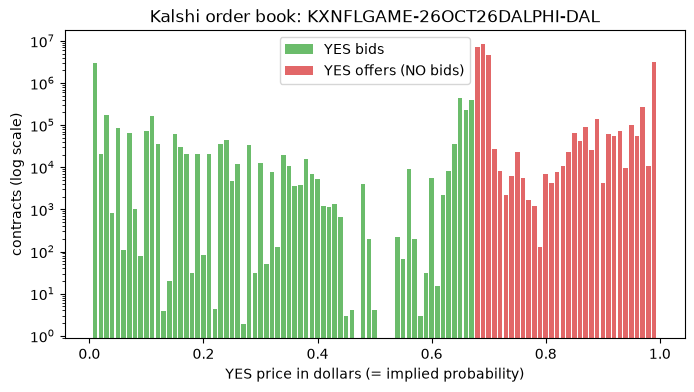
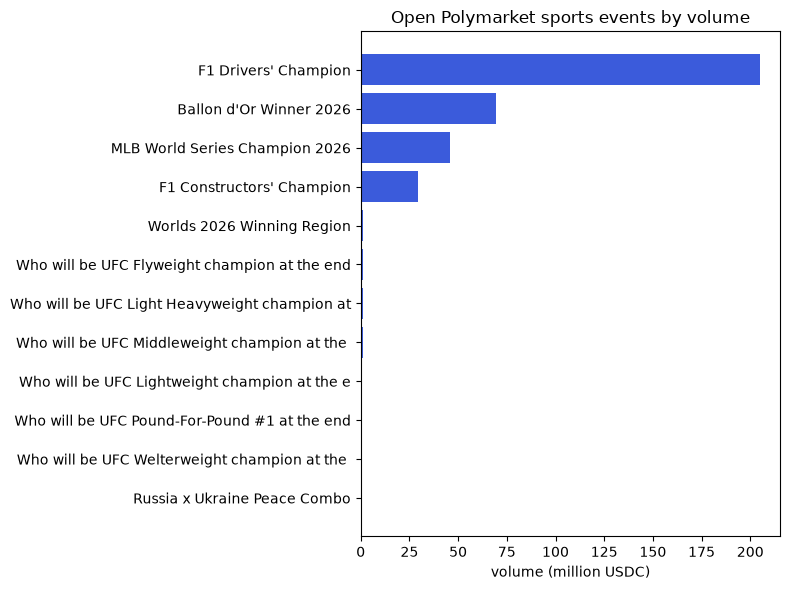

# 📈 Prediction markets with `sportsdataverse-py`

> This page is the executed notebook [`18_prediction_markets_intro.ipynb`](https://github.com/sportsdataverse/sportsdataverse-py/blob/main/examples/notebooks/18_prediction_markets_intro.ipynb): [download it](https://raw.githubusercontent.com/sportsdataverse/sportsdataverse-py/main/examples/notebooks/18_prediction_markets_intro.ipynb) to run it yourself.

Sportsbooks quote odds; prediction markets quote prices. A YES contract that pays $1 and trades at
$0.62 is a 62% implied probability, set by whoever is trading it. `sportsdataverse.odds` wraps the
public market-data APIs of the two biggest venues:

| Venue | Functions | Auth |
|---|---|---|
| [Kalshi](https://kalshi.com) | `kalshi_*` | none for market data |
| [Polymarket](https://polymarket.com) | `polymarket_gamma_*` (catalog), `polymarket_clob_*` (order book) | none |

Sportsbook odds from The Odds API live in `12_odds_intro`. This notebook only reads public prices;
it places no orders.

## 🧰 The toolbox

| Function | What it gives you |
|---|---|
| [`kalshi_exchange_status`](../odds/reference/kalshi.md#kalshi_exchange_status) | Is the exchange open for trading? |
| [`kalshi_series_list`](../odds/reference/kalshi.md#kalshi_series_list) | Market families (series) in a category |
| [`kalshi_events`](../odds/reference/kalshi.md#kalshi_events) | Events, filterable by series and status |
| [`kalshi_markets`](../odds/reference/kalshi.md#kalshi_markets) | Markets of an event, with bid / ask / last price |
| [`kalshi_orderbook`](../odds/reference/kalshi.md#kalshi_orderbook) | Order book of one market |
| [`kalshi_trades`](../odds/reference/kalshi.md#kalshi_trades) | Public trades |
| [`polymarket_gamma_events`](../odds/reference/polymarket.md#polymarket_gamma_events) | Events, filterable by tag (`sports`, ...) |
| [`polymarket_gamma_markets`](../odds/reference/polymarket.md#polymarket_gamma_markets) | Markets with outcomes, prices and volume |
| [`polymarket_clob_midpoint`](../odds/reference/polymarket.md#polymarket_clob_midpoint) | Midpoint of one outcome token's book |

## 🔌 Setup

```sh
pip install sportsdataverse
```

The Kalshi and Polymarket helpers take their paging arguments (`limit`, `offset`) as strings, the way
the APIs document them.


```python
import json

import matplotlib.pyplot as plt
import polars as pl

from sportsdataverse import odds

pl.Config.set_tbl_rows(10)
pl.Config.set_fmt_str_lengths(60)
```


    polars.config.Config


Provider feeds are seasonal and occasionally rate-limited, so a tiny `safe()` helper runs each call
defensively: you get the frame when the feed is up, and a one-line skip when it isn't, naming whether
the answer was *nothing there* (`NoDataError`) or *the fetch failed* (`AssetFetchError`). 🛟


```python
from sportsdataverse.errors import AssetFetchError, NoDataError

def safe(label, thunk):
    try:
        out = thunk()
        print(f"✅ {label}")
        return out
    except (NoDataError, AssetFetchError) as e:
        print(f"\u23ed\ufe0f  {label}: {type(e).__name__}: {e}")
        return None
```

## 🏦 Kalshi

Kalshi groups markets as series (a market family, such as single NFL games), events (one game) and
markets (one contract). Start with the exchange status and the sports series.


```python
safe("Kalshi status", odds.kalshi_exchange_status)
```

    ✅ Kalshi status


    shape: (1, 4)
    ┌─────────────────┬───────────────────────────────┬───────────────────────────────┬────────────────┐
    │ exchange_active ┆ exchange_index_statuses       ┆ intra_exchange_transfers_acti ┆ trading_active │
    │ ---             ┆ ---                           ┆ ve                            ┆ ---            │
    │ bool            ┆ str                           ┆ ---                           ┆ bool           │
    │                 ┆                               ┆ bool                          ┆                │
    ╞═════════════════╪═══════════════════════════════╪═══════════════════════════════╪════════════════╡
    │ true            ┆ [{"description": "Default",   ┆ true                          ┆ true           │
    │                 ┆ "exchange_active": true,      ┆                               ┆                │
    │                 ┆ "exchan…                      ┆                               ┆                │
    └─────────────────┴───────────────────────────────┴───────────────────────────────┴────────────────┘


```python
series = safe("Kalshi sports series", lambda: odds.kalshi_series_list(category="Sports"))
(series.filter(pl.col("title").str.contains("(?i)NFL|NBA|NHL|college"))
       .select("ticker", "title", "frequency").head(10)
 if series is not None and series.height else "series unavailable")
```

    ✅ Kalshi sports series


    shape: (10, 3)
    ┌────────────────────┬─────────────────────────────────────────────────────────┬───────────┐
    │ ticker             ┆ title                                                   ┆ frequency │
    │ ---                ┆ ---                                                     ┆ ---       │
    │ str                ┆ str                                                     ┆ str       │
    ╞════════════════════╪═════════════════════════════════════════════════════════╪═══════════╡
    │ KXNCAAMBBIG12REG   ┆ Men's College Basketball Big 12 Regular Season Champion ┆ custom    │
    │ KXNFLDRAFTSELECT   ┆ NFL Draft Exact Selection                               ┆ custom    │
    │ KXNCAAF1HFT        ┆ College Football 1st Half Fulltime Result               ┆ custom    │
    │ KXNCAAWBTOTAL      ┆ Women's College Basketball Total Points                 ┆ custom    │
    │ KXNHLNORRIS        ┆ NHL James Norris Memorial Trophy                        ┆ annual    │
    │ KXNCAAFFIRSTTDTEAM ┆ College Football First Team to Score a Touchdown        ┆ custom    │
    │ KXNFLCAREERRSHTDS  ┆ NFL Career Rushing Touchdowns                           ┆ custom    │
    │ KXNFLCAREERPASSYDS ┆ NFL Career Passing Yards                                ┆ custom    │
    │ KXNBA2QTOTAL       ┆ NBA 2nd Quarter Total                                   ┆ custom    │
    │ KXNBAGAMES         ┆ NBA games                                               ┆ daily     │
    └────────────────────┴─────────────────────────────────────────────────────────┴───────────┘


### One NFL game market and its order book 📊

`KXNFLGAME` is the single-game NFL series. Take its first open event, list the markets
([`kalshi_markets`](../odds/reference/kalshi.md#kalshi_markets)), then read one market's book
([`kalshi_orderbook`](../odds/reference/kalshi.md#kalshi_orderbook)). The book holds bids only, on both
sides; prices and sizes arrive as strings, so we cast them before plotting.


```python
events = safe("Kalshi NFL events", lambda: odds.kalshi_events(limit="10", status="open", series_ticker="KXNFLGAME"))
event = events["event_ticker"][0] if events is not None and events.height else None
mkts = safe(f"markets {event}", lambda: odds.kalshi_markets(event_ticker=event)) if event else None
cols = ["ticker", "title", "yes_bid_dollars", "yes_ask_dollars", "last_price_dollars", "volume_fp"]
mkts.select([c for c in cols if c in mkts.columns]) if mkts is not None and mkts.height else "no open NFL events"
```

    ✅ Kalshi NFL events
    ✅ markets KXNFLGAME-26OCT26DALPHI


    shape: (2, 6)
    ┌─────────────────┬─────────────────┬────────────────┬────────────────┬────────────────┬───────────┐
    │ ticker          ┆ title           ┆ yes_bid_dollar ┆ yes_ask_dollar ┆ last_price_dol ┆ volume_fp │
    │ ---             ┆ ---             ┆ s              ┆ s              ┆ lars           ┆ ---       │
    │ str             ┆ str             ┆ ---            ┆ ---            ┆ ---            ┆ str       │
    │                 ┆                 ┆ str            ┆ str            ┆ str            ┆           │
    ╞═════════════════╪═════════════════╪════════════════╪════════════════╪════════════════╪═══════════╡
    │ KXNFLGAME-26OCT ┆ Philadelphia    ┆ 0.3100         ┆ 0.3200         ┆ 0.3200         ┆ 721704.90 │
    │ 26DALPHI-PHI    ┆ wins            ┆                ┆                ┆                ┆           │
    │ KXNFLGAME-26OCT ┆ Dallas wins     ┆ 0.6700         ┆ 0.6800         ┆ 0.6800         ┆ 556008.54 │
    │ 26DALPHI-DAL    ┆                 ┆                ┆                ┆                ┆           │
    └─────────────────┴─────────────────┴────────────────┴────────────────┴────────────────┴───────────┘


```python
ticker = mkts["ticker"][0] if mkts is not None and mkts.height else None
book = safe(f"order book {ticker}", lambda: odds.kalshi_orderbook(ticker)) if ticker else None
if book is not None and book.height:
    fig, ax = plt.subplots(figsize=(8, 4))
    book = book.with_columns(pl.col("price", "size").cast(pl.Float64))
    yes = book.filter(pl.col("side") == "yes")
    # A NO bid at p is an offer to sell YES at 1 - p, so both sides fit on one YES-price axis.
    no = book.filter(pl.col("side") == "no").with_columns(price=1 - pl.col("price"))
    ax.bar(yes["price"], yes["size"], width=0.008, color="#2ca02c", alpha=0.7, label="YES bids")
    ax.bar(no["price"], no["size"], width=0.008, color="#d62728", alpha=0.7, label="YES offers (NO bids)")
    ax.set_yscale("log")
    ax.set_xlabel("YES price in dollars (= implied probability)")
    ax.set_ylabel("contracts (log scale)")
    ax.set_title(f"Kalshi order book: {ticker}")
    ax.legend()
    plt.show()
else:
    print("no order book to draw")
```

    ✅ order book KXNFLGAME-26OCT26DALPHI-PHI





```python
trades = safe(f"trades {ticker}", lambda: odds.kalshi_trades(limit="20", ticker=ticker)) if ticker else None
trades.head() if trades is not None and trades.height else "no recent trades"
```

    ✅ trades KXNFLGAME-26OCT26DALPHI-PHI


    shape: (5, 10)
    ┌──────────┬───────────┬───────────┬───────────┬───┬───────────┬───────────┬───────────┬───────────┐
    │ count_fp ┆ created_t ┆ is_block_ ┆ no_price_ ┆ … ┆ taker_sid ┆ ticker    ┆ trade_id  ┆ yes_price │
    │ ---      ┆ ime       ┆ trade     ┆ dollars   ┆   ┆ e         ┆ ---       ┆ ---       ┆ _dollars  │
    │ str      ┆ ---       ┆ ---       ┆ ---       ┆   ┆ ---       ┆ str       ┆ str       ┆ ---       │
    │          ┆ str       ┆ bool      ┆ str       ┆   ┆ str       ┆           ┆           ┆ str       │
    ╞══════════╪═══════════╪═══════════╪═══════════╪═══╪═══════════╪═══════════╪═══════════╪═══════════╡
    │ 14.91    ┆ 2026-10-2 ┆ false     ┆ 0.6800    ┆ … ┆ yes       ┆ KXNFLGAME ┆ 0724ab06- ┆ 0.3200    │
    │          ┆ 6T08:23:2 ┆           ┆           ┆   ┆           ┆ -26OCT26D ┆ 0b29-83ff ┆           │
    │          ┆ 1.219164Z ┆           ┆           ┆   ┆           ┆ ALPHI-PHI ┆ -908c-143 ┆           │
    │          ┆           ┆           ┆           ┆   ┆           ┆           ┆ 3676aadb8 ┆           │
    │ 13.60    ┆ 2026-10-2 ┆ false     ┆ 0.6800    ┆ … ┆ yes       ┆ KXNFLGAME ┆ 0724ab04- ┆ 0.3200    │
    │          ┆ 6T08:22:5 ┆           ┆           ┆   ┆           ┆ -26OCT26D ┆ 9589-bb73 ┆           │
    │          ┆ 6.209996Z ┆           ┆           ┆   ┆           ┆ ALPHI-PHI ┆ -fac8-d87 ┆           │
    │          ┆           ┆           ┆           ┆   ┆           ┆           ┆ 33fc7cacc ┆           │
    │ 74.57    ┆ 2026-10-2 ┆ false     ┆ 0.6800    ┆ … ┆ yes       ┆ KXNFLGAME ┆ 0724ab0a- ┆ 0.3200    │
    │          ┆ 6T08:22:1 ┆           ┆           ┆   ┆           ┆ -26OCT26D ┆ d069-a4cb ┆           │
    │          ┆ 9.463875Z ┆           ┆           ┆   ┆           ┆ ALPHI-PHI ┆ -0c9f-96b ┆           │
    │          ┆           ┆           ┆           ┆   ┆           ┆           ┆ 2df68711c ┆           │
    │ 5.00     ┆ 2026-10-2 ┆ false     ┆ 0.6800    ┆ … ┆ yes       ┆ KXNFLGAME ┆ 0724ab09- ┆ 0.3200    │
    │          ┆ 6T08:22:0 ┆           ┆           ┆   ┆           ┆ -26OCT26D ┆ 97e9-8d3b ┆           │
    │          ┆ 7.376608Z ┆           ┆           ┆   ┆           ┆ ALPHI-PHI ┆ -0d60-b19 ┆           │
    │          ┆           ┆           ┆           ┆   ┆           ┆           ┆ abf761e48 ┆           │
    │ 5.62     ┆ 2026-10-2 ┆ false     ┆ 0.6900    ┆ … ┆ no        ┆ KXNFLGAME ┆ 0724a83f- ┆ 0.3100    │
    │          ┆ 6T08:22:0 ┆           ┆           ┆   ┆           ┆ -26OCT26D ┆ ed09-b1ce ┆           │
    │          ┆ 5.713199Z ┆           ┆           ┆   ┆           ┆ ALPHI-PHI ┆ -5a65-27c ┆           │
    │          ┆           ┆           ┆           ┆   ┆           ┆           ┆ 3abf8693f ┆           │
    └──────────┴───────────┴───────────┴───────────┴───┴───────────┴───────────┴───────────┴───────────┘


## 🔮 Polymarket

Polymarket has two public hosts: Gamma (the catalog of events and markets) and the CLOB (the order
books). [`polymarket_gamma_events`](../odds/reference/polymarket.md#polymarket_gamma_events) with
`tag_slug="sports"` lists the open events Polymarket tags as sports (its own tagging, so an
odd non-sport event can slip in); volume is in USDC.


```python
pev = safe("Polymarket sports events",
           lambda: odds.polymarket_gamma_events(limit="20", closed="false", tag_slug="sports"))
if pev is not None and pev.height:
    top = pev.with_columns(pl.col("volume").cast(pl.Float64, strict=False)).sort("volume").tail(12)
    fig, ax = plt.subplots(figsize=(8, 6))
    ax.barh([t[:45] for t in top["title"]], top["volume"] / 1e6, color="#3b5bdb")
    ax.set_xlabel("volume (million USDC)")
    ax.set_title("Open Polymarket sports events by volume")
    plt.tight_layout()
    plt.show()
else:
    print("no Polymarket sports events")
```

    ✅ Polymarket sports events





### From catalog to order book 🔗

A Gamma market lists its outcomes, their prices, and the CLOB token id of each outcome
(`clob_token_ids`, a JSON list as text). That token id is what
[`polymarket_clob_midpoint`](../odds/reference/polymarket.md#polymarket_clob_midpoint) takes.


```python
pmk = safe("Polymarket markets by volume",
           lambda: odds.polymarket_gamma_markets(limit="5", closed="false", order="volume", ascending="false"))
pmk.select("question", "outcomes", "outcome_prices", "volume") if pmk is not None and pmk.height else None
```

    ✅ Polymarket markets by volume


    shape: (5, 4)
    ┌─────────────────────────────────┬────────────────────────────┬────────────────────┬───────────┐
    │ question                        ┆ outcomes                   ┆ outcome_prices     ┆ volume    │
    │ ---                             ┆ ---                        ┆ ---                ┆ ---       │
    │ str                             ┆ str                        ┆ str                ┆ str       │
    ╞═════════════════════════════════╪════════════════════════════╪════════════════════╪═══════════╡
    │ Will York City FC win on        ┆ ["Yes", "No"]              ┆ ["0.295", "0.705"] ┆ 99.997143 │
    │ 2026-10-03?                     ┆                            ┆                    ┆           │
    │ Sheffield Wednesday FC vs.      ┆ ["Over", "Under"]          ┆ ["0.17", "0.83"]   ┆ 99.996667 │
    │ Cambridge United FC: O/U 4.5    ┆                            ┆                    ┆           │
    │ Al Ahli Saudi FC vs. Al Gharafa ┆ ["Over", "Under"]          ┆ ["0.17", "0.83"]   ┆ 99.996667 │
    │ SC: O/U 5.5                     ┆                            ┆                    ┆           │
    │ Spread: Como 1907 (-1.5)        ┆ ["Como 1907", "Torino FC"] ┆ ["0.315", "0.685"] ┆ 99.992259 │
    │ Rot-Weiss Essen vs. RB Leipzig: ┆ ["Over", "Under"]          ┆ ["0.17", "0.83"]   ┆ 99.991177 │
    │ O/U 5.5                         ┆                            ┆                    ┆           │
    └─────────────────────────────────┴────────────────────────────┴────────────────────┴───────────┘


```python
if pmk is not None and pmk.height and pmk["clob_token_ids"][0]:
    token = json.loads(pmk["clob_token_ids"][0])[0]
    mid = safe("CLOB midpoint", lambda: odds.polymarket_clob_midpoint(token))
    out = mid
else:
    out = "no token id to look up"
out
```

    ✅ CLOB midpoint


    shape: (1, 1)
    ┌───────┐
    │ mid   │
    │ ---   │
    │ str   │
    ╞═══════╡
    │ 0.295 │
    └───────┘


## 🎉 Where to next

- Compare a market's price with a sportsbook's no-vig probability from `12_odds_intro`.
- `kalshi_series` / `kalshi_event` / `kalshi_market` fetch one record by ticker;
  `polymarket_clob_book` / `polymarket_clob_price` read the full book or one side.
- Full reference: the **Odds** pages in the sidebar.
