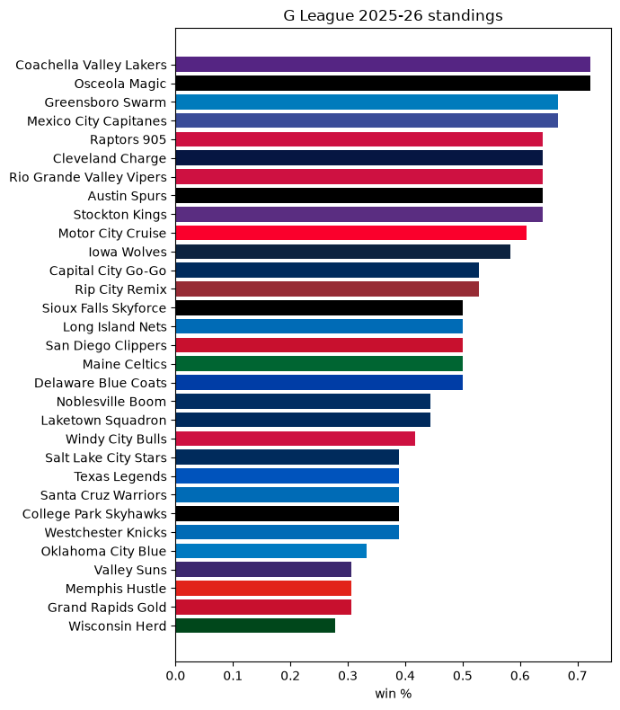
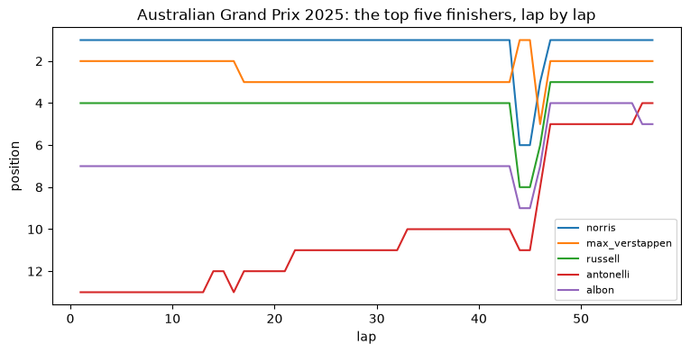

# 🧭 More sources with `sportsdataverse-py`

> This page is the executed notebook [`19_more_sources_intro.ipynb`](https://github.com/sportsdataverse/sportsdataverse-py/blob/main/examples/notebooks/19_more_sources_intro.ipynb): [download it](https://raw.githubusercontent.com/sportsdataverse/sportsdataverse-py/main/examples/notebooks/19_more_sources_intro.ipynb) to run it yourself.

Four smaller surfaces, one notebook:

| Surface | Module | Provider |
|---|---|---|
| NBA G League | `sportsdataverse.nbagl` | ESPN |
| Formula 1 | `sportsdataverse.f1` | Jolpica (the Ergast API successor) |
| TheSportsDB | `sportsdataverse.providers.thesportsdb` | TheSportsDB (free tier) |
| ESPN content | `sportsdataverse.providers.espn_content` | ESPN news API |

No API keys needed.

## 🧰 The toolbox

| Function | What it gives you |
|---|---|
| [`espn_nbagl_standings`](../nbagl/reference/site.md#espn_nbagl_standings) | G League standings |
| [`espn_nbagl_scoreboard`](../nbagl/reference/site.md#espn_nbagl_scoreboard) | G League scoreboard |
| [`f1_schedule`](../f1/reference/f1.md#f1_schedule) | Race calendar of a season |
| [`f1_driver_standings`](../f1/reference/f1.md#f1_driver_standings) | Drivers' championship |
| [`f1_results`](../f1/reference/f1.md#f1_results) | Race classification |
| [`f1_laps`](../f1/reference/additional.md#f1_laps) | Every lap of a race, all pages |
| [`thesportsdb_leagues`](../thesportsdb/reference/thesportsdb.md#thesportsdb_leagues) | Leagues TheSportsDB knows |
| [`thesportsdb_table`](../thesportsdb/reference/thesportsdb.md#thesportsdb_table) | A league table |
| [`espn_content_news`](../espn_content/reference/espn_content.md#espn_content_news) | Cross-sport headlines |
| [`espn_content_league_news`](../espn_content/reference/espn_content.md#espn_content_league_news) | Headlines for one league |

## 🔌 Setup

```sh
pip install "sportsdataverse[sdvplot]"
```


```python
import matplotlib.pyplot as plt
import polars as pl

from sportsdataverse import f1, nbagl
from sportsdataverse.providers import espn_content, thesportsdb

pl.Config.set_tbl_rows(10)
pl.Config.set_fmt_str_lengths(60)
```


    polars.config.Config


Provider feeds are seasonal and occasionally rate-limited, so a tiny `safe()` helper runs each call
defensively: you get the frame when the feed is up, and a one-line skip when it isn't, naming whether
the answer was *nothing there* (`NoDataError`) or *the fetch failed* (`AssetFetchError`). 🛟


```python
from sportsdataverse.errors import AssetFetchError, NoDataError

def safe(label, thunk):
    try:
        out = thunk()
        print(f"✅ {label}")
        return out
    except (NoDataError, AssetFetchError) as e:
        print(f"\u23ed\ufe0f  {label}: {type(e).__name__}: {e}")
        return None
```

## 🏀 NBA G League

The G League rides the cross-league ESPN wrappers (`espn_nbagl_*`).
[`espn_nbagl_standings`](../nbagl/reference/site.md#espn_nbagl_standings) takes a `season` (END year),
and sdvplot's `team_colors("nbagl", ...)` resolves ESPN team ids to each team's color.

The `nbagl_enhanced_pbp` / `nbagl_possessions` / `nbagl_rapm_from_games` helpers in the same module
read stats.nba.com, which blocks datacenter IPs, so this notebook does not call them.


```python
import sdvplot

gst = safe("G League standings 2026", lambda: nbagl.espn_nbagl_standings(season=2026))
if gst is not None and gst.height:
    top = gst.sort("win_percent", "point_differential")
    colors = [c or "#999999" for c in sdvplot.team_colors("nbagl", [str(i) for i in top["team_id"]])]
    fig, ax = plt.subplots(figsize=(7, 8))
    ax.barh(top["team_display_name"], top["win_percent"], color=colors)
    ax.set_xlabel("win %")
    ax.set_title("G League 2025-26 standings")
    plt.tight_layout()
    plt.show()
else:
    print("standings unavailable")
```

    ✅ G League standings 2026





```python
gsb = safe("G League scoreboard", nbagl.espn_nbagl_scoreboard)
cols = ["date", "short_name", "status_type_detail", "home_score", "away_score"]
gsb.select([c for c in cols if c in gsb.columns]).head() if gsb is not None and gsb.height else "no games today"
```

    ✅ G League scoreboard


    shape: (5, 5)
    ┌───────────────────┬────────────┬──────────────────────────────────┬────────────┬────────────┐
    │ date              ┆ short_name ┆ status_type_detail               ┆ home_score ┆ away_score │
    │ ---               ┆ ---        ┆ ---                              ┆ ---        ┆ ---        │
    │ str               ┆ str        ┆ str                              ┆ str        ┆ str        │
    ╞═══════════════════╪════════════╪══════════════════════════════════╪════════════╪════════════╡
    │ 2026-11-07T00:00Z ┆ WES @ MNE  ┆ Fri, November 6th at 7:00 PM EST ┆ 0          ┆ 0          │
    │ 2026-11-07T00:00Z ┆ LIN @ GBO  ┆ Fri, November 6th at 7:00 PM EST ┆ 0          ┆ 0          │
    │ 2026-11-07T00:00Z ┆ CAP @ DEL  ┆ Fri, November 6th at 7:00 PM EST ┆ 0          ┆ 0          │
    │ 2026-11-07T00:00Z ┆ RAP @ CPS  ┆ Fri, November 6th at 7:00 PM EST ┆ 0          ┆ 0          │
    │ 2026-11-07T01:00Z ┆ NOB @ WCB  ┆ Fri, November 6th at 8:00 PM EST ┆ 0          ┆ 0          │
    └───────────────────┴────────────┴──────────────────────────────────┴────────────┴────────────┘


## 🏎️ Formula 1

The F1 helpers take `season` and `round` as strings.
[`f1_driver_standings`](../f1/reference/f1.md#f1_driver_standings) returns the table after a season's
last round; [`f1_laps`](../f1/reference/additional.md#f1_laps) pages through every lap of a race.


```python
F1_SEASON = "2025"
dst = safe(f"F1 driver standings {F1_SEASON}", lambda: f1.f1_driver_standings(F1_SEASON))
cols = ["position", "driver_given_name", "driver_family_name", "constructors", "points", "wins"]
dst.select([c for c in cols if c in dst.columns]).head(10) if dst is not None else None
```

    ✅ F1 driver standings 2025


    shape: (10, 6)
    ┌──────────┬───────────────────┬────────────────────┬──────────────────────────────┬────────┬──────┐
    │ position ┆ driver_given_name ┆ driver_family_name ┆ constructors                 ┆ points ┆ wins │
    │ ---      ┆ ---               ┆ ---                ┆ ---                          ┆ ---    ┆ ---  │
    │ i64      ┆ str               ┆ str                ┆ str                          ┆ f64    ┆ i64  │
    ╞══════════╪═══════════════════╪════════════════════╪══════════════════════════════╪════════╪══════╡
    │ 1        ┆ Lando             ┆ Norris             ┆ [{"constructorId":           ┆ 423.0  ┆ 7    │
    │          ┆                   ┆                    ┆ "mclaren", "url":            ┆        ┆      │
    │          ┆                   ┆                    ┆ "https://en.wikipedia.o…     ┆        ┆      │
    │ 2        ┆ Max               ┆ Verstappen         ┆ [{"constructorId":           ┆ 421.0  ┆ 8    │
    │          ┆                   ┆                    ┆ "red_bull", "url":           ┆        ┆      │
    │          ┆                   ┆                    ┆ "https://en.wikipedia.…      ┆        ┆      │
    │ 3        ┆ Oscar             ┆ Piastri            ┆ [{"constructorId":           ┆ 410.0  ┆ 7    │
    │          ┆                   ┆                    ┆ "mclaren", "url":            ┆        ┆      │
    │          ┆                   ┆                    ┆ "https://en.wikipedia.o…     ┆        ┆      │
    │ 4        ┆ George            ┆ Russell            ┆ [{"constructorId":           ┆ 319.0  ┆ 2    │
    │          ┆                   ┆                    ┆ "mercedes", "url":           ┆        ┆      │
    │          ┆                   ┆                    ┆ "https://en.wikipedia.…      ┆        ┆      │
    │ 5        ┆ Charles           ┆ Leclerc            ┆ [{"constructorId":           ┆ 242.0  ┆ 0    │
    │          ┆                   ┆                    ┆ "ferrari", "url":            ┆        ┆      │
    │          ┆                   ┆                    ┆ "https://en.wikipedia.o…     ┆        ┆      │
    │ 6        ┆ Lewis             ┆ Hamilton           ┆ [{"constructorId":           ┆ 156.0  ┆ 0    │
    │          ┆                   ┆                    ┆ "ferrari", "url":            ┆        ┆      │
    │          ┆                   ┆                    ┆ "https://en.wikipedia.o…     ┆        ┆      │
    │ 7        ┆ Andrea Kimi       ┆ Antonelli          ┆ [{"constructorId":           ┆ 150.0  ┆ 0    │
    │          ┆                   ┆                    ┆ "mercedes", "url":           ┆        ┆      │
    │          ┆                   ┆                    ┆ "https://en.wikipedia.…      ┆        ┆      │
    │ 8        ┆ Alexander         ┆ Albon              ┆ [{"constructorId":           ┆ 73.0   ┆ 0    │
    │          ┆                   ┆                    ┆ "williams", "url":           ┆        ┆      │
    │          ┆                   ┆                    ┆ "https://en.wikipedia.…      ┆        ┆      │
    │ 9        ┆ Carlos            ┆ Sainz              ┆ [{"constructorId":           ┆ 64.0   ┆ 0    │
    │          ┆                   ┆                    ┆ "williams", "url":           ┆        ┆      │
    │          ┆                   ┆                    ┆ "https://en.wikipedia.…      ┆        ┆      │
    │ 10       ┆ Fernando          ┆ Alonso             ┆ [{"constructorId":           ┆ 56.0   ┆ 0    │
    │          ┆                   ┆                    ┆ "aston_martin", "url":       ┆        ┆      │
    │          ┆                   ┆                    ┆ "https://en.wikipe…          ┆        ┆      │
    └──────────┴───────────────────┴────────────────────┴──────────────────────────────┴────────┴──────┘


```python
laps = safe(f"F1 laps {F1_SEASON} round 1", lambda: f1.f1_laps(F1_SEASON, "1"))
res = safe(f"F1 results {F1_SEASON} round 1", lambda: f1.f1_results(F1_SEASON, "1"))
if laps is not None and laps.height and res is not None and res.height:
    top5 = res.sort(pl.col("position").cast(pl.Int64, strict=False)).head(5)["driver_id"].to_list()
    fig, ax = plt.subplots(figsize=(9, 4))
    for d in top5:
        s = laps.filter(pl.col("driver_id") == d).sort("lap_number")
        ax.plot(s["lap_number"], s["position"].cast(pl.Int64, strict=False), label=d)
    ax.invert_yaxis()
    ax.set_xlabel("lap")
    ax.set_ylabel("position")
    ax.set_title(f"{res['race_name'][0]} {F1_SEASON}: the top five finishers, lap by lap")
    ax.legend(fontsize=8)
    plt.show()
else:
    print("lap data unavailable")
```

    ✅ F1 laps 2025 round 1


    ✅ F1 results 2025 round 1





## 📚 TheSportsDB

TheSportsDB's free tier serves a sample of its catalog (a handful of leagues, five rows of a table),
which is enough to see the shape. [`thesportsdb_table`](../thesportsdb/reference/thesportsdb.md#thesportsdb_table)
takes the league id and a season label such as `"2024-2025"` (4328 is the English Premier League).


```python
safe("TheSportsDB leagues", thesportsdb.thesportsdb_leagues)
```

    ✅ TheSportsDB leagues


    shape: (10, 3)
    ┌───────────┬─────────────────────────────┬───────────┐
    │ id_league ┆ str_league                  ┆ str_sport │
    │ ---       ┆ ---                         ┆ ---       │
    │ str       ┆ str                         ┆ str       │
    ╞═══════════╪═════════════════════════════╪═══════════╡
    │ 4328      ┆ English Premier League      ┆ Soccer    │
    │ 4329      ┆ English League Championship ┆ Soccer    │
    │ 4330      ┆ Scottish Premier League     ┆ Soccer    │
    │ 4331      ┆ German Bundesliga           ┆ Soccer    │
    │ 4332      ┆ Italian Serie A             ┆ Soccer    │
    │ 4334      ┆ French Ligue 1              ┆ Soccer    │
    │ 4335      ┆ Spanish La Liga             ┆ Soccer    │
    │ 4336      ┆ Greek Super League 1        ┆ Soccer    │
    │ 4337      ┆ Dutch Eredivisie            ┆ Soccer    │
    │ 4338      ┆ Belgian Pro League          ┆ Soccer    │
    └───────────┴─────────────────────────────┴───────────┘


```python
epl = safe("EPL table 2024-2025", lambda: thesportsdb.thesportsdb_table("4328", "2024-2025"))
cols = ["int_rank", "str_team", "int_played", "int_win", "int_draw", "int_loss", "int_points"]
epl.select([c for c in cols if c in epl.columns]) if epl is not None else None
```

    ✅ EPL table 2024-2025


    shape: (5, 7)
    ┌──────────┬──────────────────┬────────────┬─────────┬──────────┬──────────┬────────────┐
    │ int_rank ┆ str_team         ┆ int_played ┆ int_win ┆ int_draw ┆ int_loss ┆ int_points │
    │ ---      ┆ ---              ┆ ---        ┆ ---     ┆ ---      ┆ ---      ┆ ---        │
    │ str      ┆ str              ┆ str        ┆ str     ┆ str      ┆ str      ┆ str        │
    ╞══════════╪══════════════════╪════════════╪═════════╪══════════╪══════════╪════════════╡
    │ 1        ┆ Liverpool        ┆ 38         ┆ 25      ┆ 9        ┆ 4        ┆ 84         │
    │ 2        ┆ Arsenal          ┆ 38         ┆ 20      ┆ 14       ┆ 4        ┆ 74         │
    │ 3        ┆ Manchester City  ┆ 38         ┆ 21      ┆ 8        ┆ 9        ┆ 71         │
    │ 4        ┆ Chelsea          ┆ 38         ┆ 20      ┆ 9        ┆ 9        ┆ 69         │
    │ 5        ┆ Newcastle United ┆ 38         ┆ 20      ┆ 6        ┆ 12       ┆ 66         │
    └──────────┴──────────────────┴────────────┴─────────┴──────────┴──────────┴────────────┘


## 📰 ESPN content

[`espn_content_news`](../espn_content/reference/espn_content.md#espn_content_news) returns cross-sport
headlines; [`espn_content_league_news`](../espn_content/reference/espn_content.md#espn_content_league_news)
takes ESPN's sport and league slugs (`"basketball"`, `"nba"`).


```python
news = safe("ESPN NBA news", lambda: espn_content.espn_content_league_news("basketball", "nba", limit="5"))
news.select("published", "headline") if news is not None and news.height else "no headlines"
```

    ✅ ESPN NBA news


    shape: (5, 2)
    ┌──────────────────────┬───────────────────────────────────────────────────────────────┐
    │ published            ┆ headline                                                      │
    │ ---                  ┆ ---                                                           │
    │ str                  ┆ str                                                           │
    ╞══════════════════════╪═══════════════════════════════════════════════════════════════╡
    │ 2026-10-26T19:09:01Z ┆ Magic's Jalen Suggs out at least 2 weeks with knee injury     │
    │ 2026-10-26T18:14:09Z ┆ Dream, Valkyries to play Game 6, WNBA Finals at State Farm a… │
    │ 2026-10-26T17:38:26Z ┆ Monday's fantasy basketball adds and bets to make in the NBA  │
    │ 2026-10-26T16:37:08Z ┆ Fantasy risers and fallers: Time to trade away Ty Jerome, dr… │
    │ 2026-10-26T16:36:05Z ┆ U.S. senators call on NBA to reevaluate Rwanda partnership    │
    └──────────────────────┴───────────────────────────────────────────────────────────────┘


## 🎉 Where to next

- The G League's ESPN surface has the same shape as every other ESPN league: see the
  **NBA G League** reference pages.
- F1 also has `f1_qualifying`, `f1_sprint`, `f1_pitstops` and the `f1_circuits` / `f1_status`
  vocabularies.
- Headlines for any league: pass its ESPN slugs to `espn_content_league_news`.
